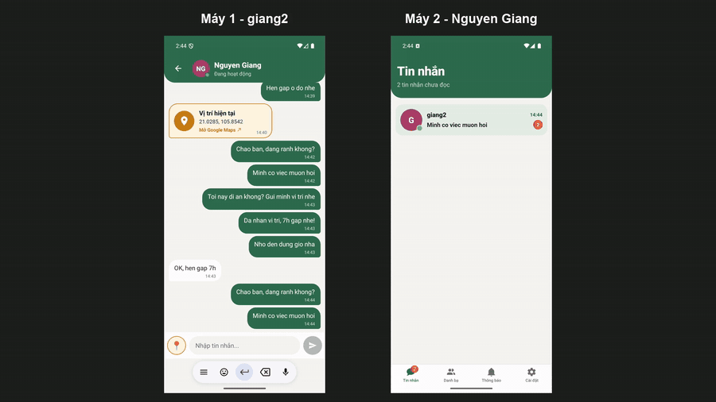
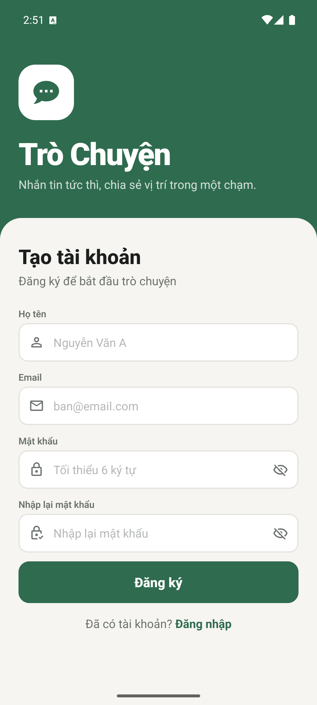
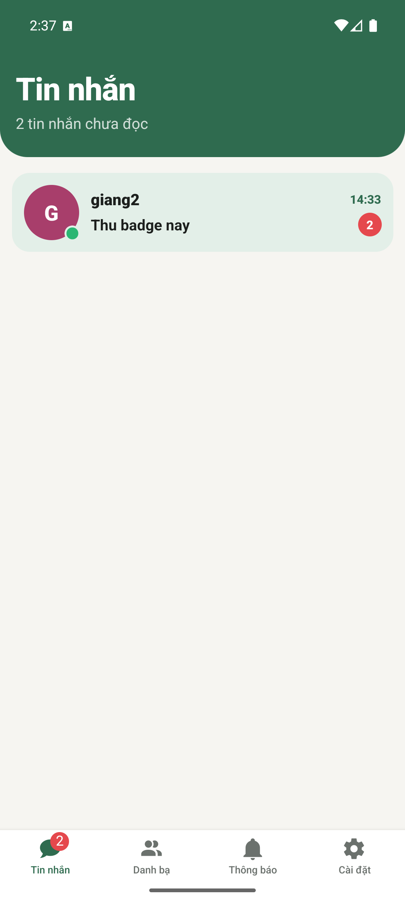
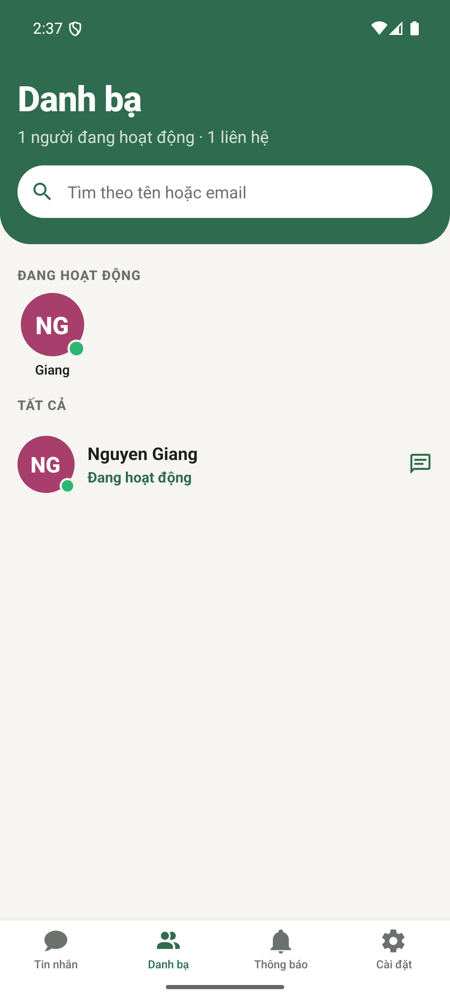
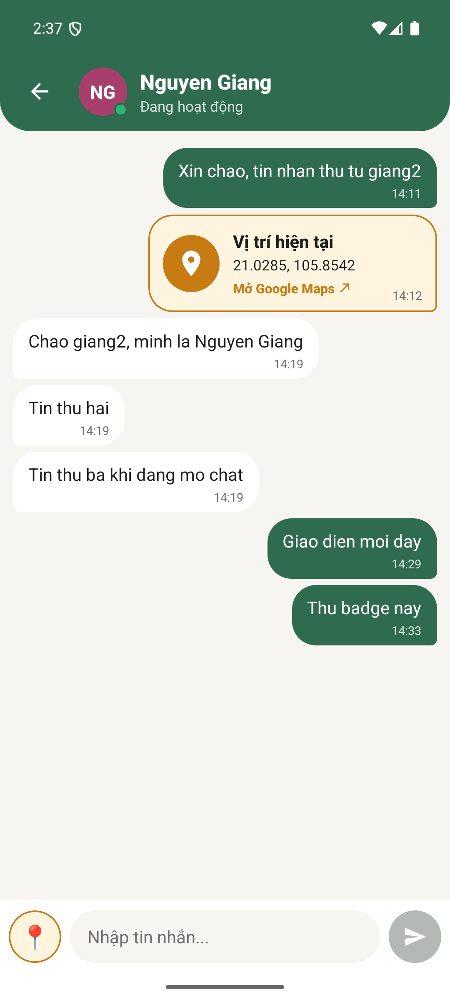
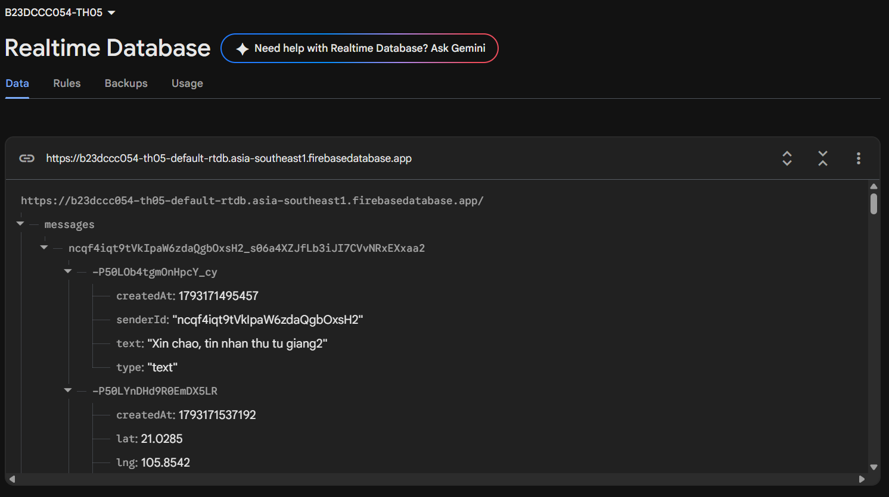

# Trò Chuyện: Chat 1-1 realtime với Firebase

Bài thực hành 5, môn Lập trình ứng dụng cho thiết bị di động (RIPT1412-20261-02).
Sinh viên: **B23DCCC054**

Đây là ứng dụng chat 1-1 viết bằng **React Native CLI**. Hai người dùng nhắn tin trực tiếp với nhau qua **Firebase Authentication** và **Firebase Realtime Database**. App hiển thị trạng thái online, gửi được vị trí hiện tại và đếm số tin chưa đọc theo thời gian thực.

<p align="center">
  
</p>

> 🎬 **Video đầy đủ (91 giây, 2 máy ảo chat với nhau):** [docs/video/demo_2_may.mp4](docs/video/demo_2_may.mp4)
> Bản quay riêng từng máy nằm trong [docs/video/raw/](docs/video/raw/).

---

## Ảnh chụp màn hình

| Đăng ký | Home có số chưa đọc | Danh bạ có trạng thái online | Chat có tin thường và tin vị trí |
|:---:|:---:|:---:|:---:|
|  |  |  |  |

### Dữ liệu tin nhắn trên Firebase Console (tab Data)



---

## Chức năng

**1. Đăng ký và đăng nhập**
- Màn Đăng ký gồm họ tên, email, mật khẩu (tối thiểu 6 ký tự) và nhập lại mật khẩu. Lỗi được báo ngay dưới từng ô.
- Đăng nhập qua Firebase Auth. Nhập sai tài khoản hoặc mật khẩu thì app hiện thông báo lỗi tiếng Việt.
- Phiên đăng nhập được giữ lại sau khi tắt app (AsyncStorage).
- Đăng xuất ở màn Cài đặt có hộp xác nhận. App chuyển người dùng sang offline rồi quay về màn Đăng nhập.

**2. Danh bạ**
- Danh sách người dùng lấy từ Firebase, không có bản thân.
- Trạng thái online/offline cập nhật realtime qua `.info/connected` và `onDisconnect`. Khi offline, app hiện "Hoạt động lúc HH:mm".
- Có ô tìm kiếm theo tên hoặc email, và một hàng avatar những người đang hoạt động.

**3. Chat 1-1**
- Tin nhắn gửi và nhận ngay lập tức, không cần tải lại màn hình.
- Tin của mình nằm bên phải, tin của người kia nằm bên trái, tin nào cũng có giờ gửi.
- Không gửi được tin rỗng. Danh sách tự cuộn xuống tin mới nhất.
- Thanh tiêu đề hiện tên và trạng thái online của người đang chat.

**4. Gửi vị trí**
- Nút 📍 xin quyền vị trí. Nếu bị từ chối, app hiện thông báo. Trên Android 12+, chọn "vị trí gần đúng" vẫn gửi được.
- Tin vị trí có khung màu cam riêng. Nhấn vào thì mở Google Maps đúng tọa độ.

**5. Home**
- Danh sách cuộc trò chuyện gồm ảnh đại diện, tên, tin nhắn cuối và thời gian. Cuộc mới nhất nằm trên cùng.
- Số tin chưa đọc tăng ngay khi có tin mới, có cả badge trên tab, và về 0 khi mở cuộc trò chuyện.

**Màn Thông báo** giữ dạng danh sách thông báo mẫu như Bài 4.

---

## Công nghệ

| Thành phần | Thư viện |
|---|---|
| Nền tảng | React Native CLI 0.88.1 (TypeScript), không dùng Expo |
| Điều hướng | `@react-navigation/native`, `native-stack`, `bottom-tabs` |
| Firebase | `firebase` JS SDK (`firebase/auth`, `firebase/database`) |
| Vị trí | `@react-native-community/geolocation` |
| Lưu phiên đăng nhập | `@react-native-async-storage/async-storage` |
| Icon | `react-native-vector-icons` (MaterialCommunityIcons) |
| Kiểm thử | Jest |

## Cấu trúc thư mục

```
src/
├── services/        # Toàn bộ code Firebase nằm ở đây
│   ├── firebase.ts          # initializeApp, Auth (AsyncStorage persistence), Database
│   ├── firebaseConfig.ts    # Cấu hình Web app của Firebase
│   ├── authService.ts       # register, login, logout, thông báo lỗi tiếng Việt
│   ├── userService.ts       # danh bạ, presence online/offline
│   ├── chatService.ts       # gửi tin/vị trí, lắng nghe tin, số chưa đọc
│   └── locationService.ts   # xin quyền và lấy vị trí hiện tại
├── context/         # AuthContext (người dùng hiện tại), ChatsContext (users + cuộc trò chuyện)
├── navigation/      # AuthStack, AppStack, MainTabs
├── screens/         # Login, Register, Home, Contacts, Chat, Notifications, Settings
├── components/      # Avatar, MessageBubble, ChatInput, ConversationItem, ...
├── hooks/           # useReduceMotion
├── utils/           # chatId, formatTime, validation, mapsUrl, avatarColor
└── theme/           # màu sắc, khoảng cách, cỡ chữ
```

Mọi listener (`onValue`, `onChildAdded`, `onAuthStateChanged`) đều được hủy trong hàm cleanup của `useEffect`, nên tin nhắn không bị hiện lặp khi vào ra màn Chat.

## Cấu trúc dữ liệu (Realtime Database)

```
users/{uid}                : { name, email, online, lastSeen }
messages/{chatId}/{msgId}  : { senderId, type: "text" | "location", text?, lat?, lng?, createdAt }
userChats/{uid}/{otherUid} : { lastMessage, lastTime, unread }
```

- `chatId` là hai uid sắp xếp theo thứ tự rồi nối bằng `_`, nên hai người luôn dùng chung một phòng.
- Mỗi lần gửi tin, app dùng **một lệnh `update()`** để ghi cùng lúc ba chỗ: tin nhắn mới, `userChats` của người gửi (`unread: 0`) và `userChats` của người nhận (`unread: increment(1)`).

Luật bảo mật nằm trong [database.rules.json](database.rules.json):
- Phải đăng nhập mới đọc được danh bạ.
- Mỗi người chỉ sửa được hồ sơ của mình.
- Chỉ hai người trong cuộc đọc được tin nhắn.
- Tin đã gửi không sửa được và không giả mạo được người gửi.

---

## Cài đặt và chạy

### 1. Chuẩn bị Firebase
1. Tạo project trên [Firebase Console](https://console.firebase.google.com) và thêm một **Web app**.
2. **Security → Authentication → Sign-in method**: bật **Email/Password**.
3. **Databases & Storage → Realtime Database**: tạo database, rồi vào tab **Rules** dán nội dung file `database.rules.json` và bấm Publish.
4. Điền cấu hình Web app (cả `databaseURL`) vào [src/services/firebaseConfig.ts](src/services/firebaseConfig.ts).

### 2. Chạy app

Cần có Node ≥ 22.11, JDK 17 và Android SDK.

```bash
npm install
npm start
```

Mở một terminal khác:

```bash
npm run android
```

### 3. Kiểm thử

```bash
npm test
npx tsc --noEmit
npx eslint .
```

Bộ test Jest có 33 test, gồm:
- Các hàm tiện ích: `chatId`, định dạng thời gian, kiểm tra form, link Google Maps.
- Thông báo lỗi đăng nhập.
- Lọc danh bạ.
- Gửi tin: chặn tin rỗng, ghi ba đường dẫn trong một lần, `increment` số chưa đọc.
- Mất mạng khi gửi tin hoặc đăng xuất.
- Tin bị server từ chối.
- Thứ tự sự kiện khi đăng ký.
- Quyền vị trí gần đúng.

---

## Thiết kế

Thiết kế chi tiết và kế hoạch triển khai:
- [docs/superpowers/specs/2026-10-28-chat-firebase-design.md](docs/superpowers/specs/2026-10-28-chat-firebase-design.md)
- [docs/superpowers/plans/2026-10-28-chat-firebase.md](docs/superpowers/plans/2026-10-28-chat-firebase.md)

Giao diện dùng tông xanh trà trên nền đá ấm, màu cam riêng cho tin vị trí và font Roboto. Các chuyển động dùng `Animated` có sẵn của React Native và tôn trọng cài đặt "Xóa hiệu ứng động" của hệ thống:
- Tin mới bay vào từ phía người gửi.
- Badge chưa đọc nảy lên khi số tăng.
- Chấm online đổi màu khi trạng thái thay đổi.
- Nút co nhẹ khi bấm.
